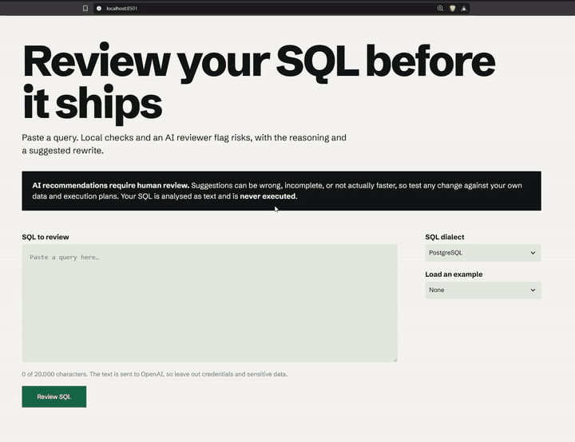
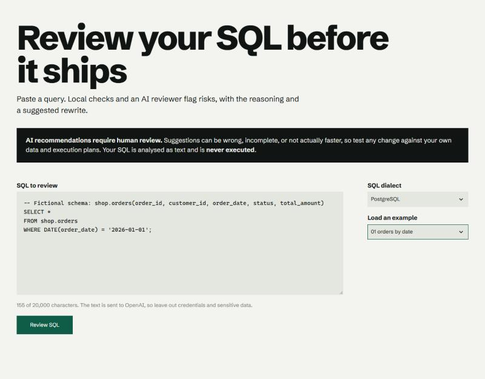
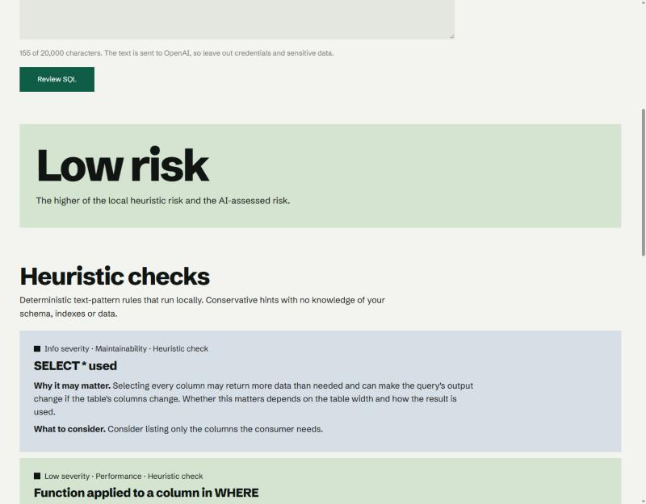

# AI SQL Reviewer

A Streamlit app that reviews SQL using the OpenAI Responses API plus a small set of local, deterministic checks. It returns structured findings (category, severity, explanation, recommendation), an overall risk rating, a suggested rewrite and caveats.






> **AI recommendations require human review.** Suggestions can be wrong, incomplete or not actually faster. Always test against your own data and execution plans.
> Submitted SQL is analysed **as text only and is never executed**.

## Features

- SQL editor, dialect selector (PostgreSQL, SQL Server, Synapse, MySQL, Oracle, SQLite, Snowflake, BigQuery, ANSI) and one-click fictional examples.
- **Two clearly separated sources of findings:** local heuristic rules and AI-generated findings, each labelled as such on every card.
- Overall risk (the higher of the heuristic and AI ratings), an AI-suggested rewrite marked "unverified", and caveats about what the reviewer could not know.
- Graceful handling of empty input, oversized input, missing API key, rate limits, network failures and malformed model output. If the AI step fails, heuristic results still appear.

## Setup (Windows PowerShell)

```powershell
cd D:\Projects\ai-sql-reviewer
python -m venv .venv                 # skip if .venv already exists
.\.venv\Scripts\Activate.ps1
pip install -r requirements.txt
```

Create a `.env` file in the project folder (it is git-ignored) containing one line:

```
OPENAI_API_KEY=your-key-here
```

Optional: `SQL_REVIEWER_MODEL=gpt-4.1-mini` (the default) to use another model.

## Run

```powershell
.\.venv\Scripts\python.exe -m streamlit run app.py
```

Open http://localhost:8501 if the browser does not open automatically.

## Tests

```powershell
.\.venv\Scripts\python.exe -m pytest -v
```

The suite (96 tests) uses mocked API clients, blocks network access, ignores your real `.env`, and costs no API credits. It covers validation, length limits, missing configuration, every API error mapping, malformed and incomplete model responses, each heuristic rule (including false-positive cases), HTML escaping of untrusted output, and the service-level merge.

`test_api.py` and `test_reviewer.py` in the project root are the original manual scripts. They call the real API, so run them by hand only for a live check.

## Architecture

```
app.py                 Streamlit page: layout and wiring only
ui/
  render.py            HTML fragments; every dynamic string is escaped
  style.css            visual design
sqlreviewer/
  config.py            env vars, limits, dialect list
  validation.py        input checks (empty, type, length, control characters)
  heuristics.py        local regex rules -> findings tagged source="heuristic"
  schema.py            JSON schema sent to the API + strict validation of the reply
  ai_client.py         the only module that calls OpenAI; maps errors to safe messages
  service.py           validate -> heuristics -> AI -> combined result
  errors.py            exceptions that carry user-safe messages
tests/                 pytest suite (mocked)
examples/              fictional-schema SQL samples
```

`app.py` calls `service.review()`, which validates the input, runs the heuristics, then calls the AI client. Heuristic and AI findings stay in separate lists all the way to the screen.

## Design decisions

- **Heuristics are conservative and hedged.** They are regex matches on text, not a parser, so every rule says what *may* go wrong and why it might be harmless, and none is rated above "medium". Comments and string literals are stripped before most rules run, to avoid false positives.
- **The AI reply is treated as untrusted.** It is requested under a strict JSON schema, then validated again in code: types, enums, required keys and sizes. Unknown keys are dropped, and anything unexpected becomes a generic user message rather than a crash or a raw error.
- **The prompt guards against speculation.** Early testing showed the model raising a "SQL injection" finding for a query containing only a fixed literal. The prompt now tells it to report injection only when the SQL itself shows dynamic construction, and to flag when a rewrite might change results (for example, column type or time zone).
- **Failure never leaks detail.** User-facing errors are fixed strings; exception text, keys and SQL are never shown or logged (only exception type names are logged).
- **Design:** one typeface, flat tonal surfaces, no gradients, shadows or emoji, and large type for the verdict. Built following the rules of the taste-skill design guide.

## Safety

- SQL is never executed, only sent as quoted text to the model, with instructions to treat it as data.
- SQL is not logged.
- The API key is read from the environment or `.env` only, and never appears in the UI or in errors.

## Limitations

- Heuristics can miss things and occasionally flag harmless code.
- The AI sees only the SQL you paste: no schema, indexes, row counts or query plans, so performance remarks are hypotheses. Model output can still vary between runs and contain mistakes.
- A suggested rewrite is not guaranteed to be equivalent or faster.
- Pasted SQL is sent to OpenAI. Don't include secrets or sensitive data.
- Input limit: 20,000 characters.
